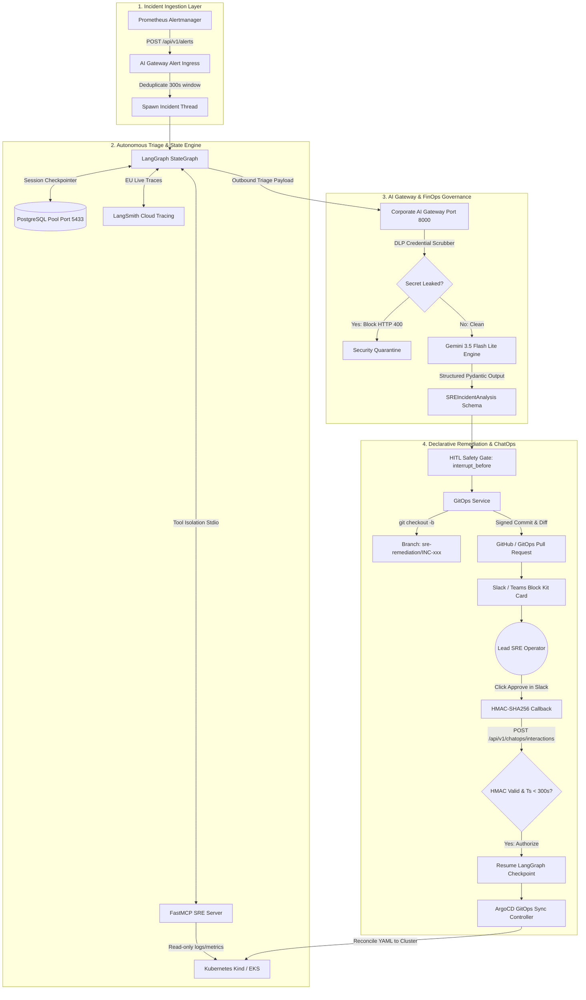

# 🛡️ Enterprise Autonomous SRE Platform

> **An event-driven, zero-trust autonomous Site Reliability Engineering platform for Kubernetes workloads.**  
> Powered by **LangGraph**, **FastMCP (Model Context Protocol)**, **Governed AI Gateway with Data Loss Prevention (DLP)**, **Declarative GitOps (ArgoCD)**, and **Cryptographic ChatOps (Slack Block Kit)**.

[](#-verification--test-harnesses)
[](#-enterprise-observability--telemetry)
[](#-architecture-topology)
[](#-key-architectural-pillars)

---

## 🏛️ Executive Architecture Summary

In enterprise production environments (e.g. Financial Services, Tier-1 Banks, Automotive Cloud Platforms), autonomous agents must **never** be given direct `kubectl exec` or write-access to live Kubernetes clusters, nor should they communicate with external LLMs unmonitored. 

This platform eliminates traditional agent anti-patterns by implementing a **governed, event-driven architecture**:
1. **Event-Driven Ingestion**: Real **Prometheus Alertmanager** webhook alerts trigger isolated incident threads with built-in deduplication.
2. **Dynamic Forensic Intelligence**: Driven by **Google AI Studio (Gemini 3.5 Flash Lite)** producing strict **Pydantic schemas** (`SREIncidentAnalysis`) rather than fragile string-matching heuristics.
3. **Data Loss Prevention (DLP) AI Gateway**: Outbound logs are scrubbed for API keys, JWT Bearer tokens, and cloud credentials before payloads cross corporate network perimeters.
4. **Tool Decoupling via FastMCP**: Kubernetes inspection and AWS cost telemetry are isolated behind a language-agnostic **Model Context Protocol (MCP)** boundary over Stdio.
5. **Declarative GitOps PR Lifecycle**: The agent never mutates cluster pods directly. Instead, it creates git remediation branches, commits declarative manifest diffs, and opens **Pull Requests** reconciled by **ArgoCD**.
6. **Cryptographic ChatOps Governance**: Operator Human-in-the-Loop approvals are dispatched via **Slack Block Kit** cards and verified using **HMAC-SHA256 signatures** with anti-replay protection.

---

## 📊 Architecture Topology



---

## 🔑 Key Architectural Pillars

### 1. Dynamic Forensic Reasoning (Pydantic Schema)
The agent utilizes structured JSON output from **Gemini 3.5 Flash Lite** enforcing a strict Pydantic model:
```python
class SREIncidentAnalysis(BaseModel):
    root_cause_category: Literal["OOM_MEMORY_LEAK", "TRANSIENT_CRASH", "DEADLOCK", "CONFIG_DRIFT", "UNKNOWN"]
    severity: Literal["P1_CRITICAL", "P2_HIGH", "P3_MEDIUM", "P4_LOW"]
    summary: str
    technical_explanation: str
    recommended_mitigation_type: Literal["PATCH_MEMORY_LIMIT", "ROLLOUT_RESTART", "ROLLBACK_DEPLOYMENT", "ESCALATE_HUMAN"]
    suggested_patch_value: Optional[str] = None
    confidence_score: float
```

### 2. Governed AI Gateway & DLP Scrubber
Every model interaction is routed through the local FastAPI AI Gateway proxy (`ai_gateway.py` on port 8000):
* **Data Loss Prevention (DLP)**: Intercepts raw diagnostic traces and sanitizes JWT tokens, AWS access keys (`AKIA...`), and Bearer headers.
* **FinOps Token Cost Metering**: Calculates exact input/output token costs against real provider pricing tables ($0.075 / 1M prompt, $0.30 / 1M completion).
* **Tenant Rate Limiting**: Enforces sliding-window request throttling per corporate client (`client-allianzgi-sre`).

### 3. FastMCP Tool Decoupling (Model Context Protocol)
Cluster operations are decoupled using Anthropic's **Model Context Protocol** (`sre_mcp_server.py`):
* The agent reasoning graph has zero direct dependencies on `kubectl` or AWS SDKs.
* Communication is strictly JSON-RPC over Standard Input/Output (Stdio), allowing tool execution to be easily sandboxed inside ephemeral MicroVMs or isolated containers.

### 4. Zero-Drift GitOps Workflow
Autonomous changes avoid the "configuration drift" anti-pattern:
* The agent uses `GitOpsRemediationService` to branch from `main`: `sre-remediation/<incident_id>`.
* The YAML manifest is patched and signed: `Signed-off-by: SRE Autonomous Agent <agent@sre.enterprise.internal>`.
* A formal Pull Request is created for **ArgoCD** declarative reconciliation.

### 5. Cryptographic ChatOps Sign-Off
Human oversight is enforced through standard **Slack Block Kit** interactive cards:
* Callbacks are validated using **HMAC-SHA256 signatures** (`X-Slack-Signature`).
* Enforces an anti-replay sliding window (rejecting requests with timestamp drift $> 300\text{s}$).

---

## 🚀 Quickstart & Verification

### Prerequisites
* Linux / macOS with Python 3.11+
* Docker & Kind (Kubernetes in Docker)
* Active `.env` file with `GEMINI_API_KEY` and `LANGSMITH_API_KEY`

```bash
# 1. Activate virtual environment
source venv/bin/activate

# 2. Start persistent checkpointer database (PostgreSQL on port 5433)
docker-compose up -d
```

### Run the Master Enterprise Verification Suite
Executes end-to-end automated assertions across all 5 architectural tiers:
```bash
python test_enterprise_suite.py
```
```text
══════════════════════════════════════════════════════════════
MASTER SUITE RUN COMPLETE: 7 PASSED, 0 FAILED
══════════════════════════════════════════════════════════════
```

### Run the Live Production Showcase Demo
Runs the live event-driven incident lifecycle in real time:
```bash
python run_demo.py
```

---

## 📈 Enterprise Observability & Telemetry

### LangSmith EU Cloud Tracing
All LangGraph state machine executions, checkpoint state serialization, and MCP tool latencies are streamed live to **LangSmith** in the European Union data region (`eu.api.smith.langchain.com`).
* **Visual Execution DAG**: Real-time tree traces of node latencies and prompt inputs.
* **State Checkpoints**: Every state change persisted to PostgreSQL (`sre_state_db`) with `psycopg_pool` connection pooling.

### Interactive Visual Control Center (Web UI)
For demo recordings and operator visibility, an interactive WebSocket dashboard is available on **port 8080**:
```bash
python web_dashboard.py
```
Visit `http://localhost:8080` to view:
* Live Kubernetes pod status & restart telemetry.
* Real-time LangGraph node execution highlights.
* One-click Chaos Injection (`/simulate/oom-leak`, `/simulate/crash`).
* Operator Human-in-the-Loop approval modal.

---

## 📁 Repository Structure

```
├── agent.py                     # LangGraph StateGraph engine & circuit breaker router
├── ai_gateway.py                # Governed AI Gateway (DLP, Gemini 3.5, Alertmanager & ChatOps)
├── sre_mcp_server.py            # FastMCP Stdio server (Kubernetes tools & AWS cost resource)
├── gitops_service.py            # Declarative Git branching, YAML patching & PR generation
├── chatops_dispatcher.py        # Slack Block Kit card generator & HMAC signature validator
├── web_dashboard.py             # Real-time WebSocket Control Center (port 8080)
├── run_demo.py                  # Live end-to-end production showcase script
├── test_enterprise_suite.py     # Master 7-point enterprise test assertion suite
├── test_alertmanager_webhook.py # Dedicated Prometheus Alertmanager ingestion test
├── test_chatops_hmac.py         # Cryptographic HMAC security test harness
├── eval_suite.py                # LLM non-deterministic assertion test suite
├── argocd/                      # ArgoCD Application manifests for cluster reconciliation
├── terraform/                   # Reusable AWS/Cloud VPC, Aurora & ECS infrastructure
└── dummy-app/                   # Target microservice with simulated failure endpoints
```

---

## 📜 License
Apache-2.0. Built for enterprise autonomous reliability and AI governance demonstration.
